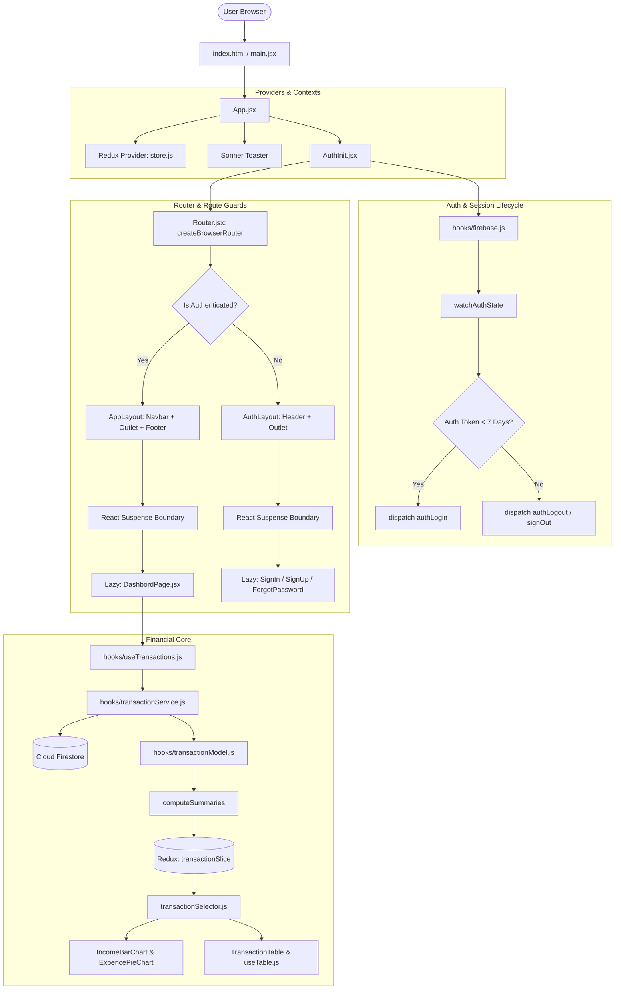
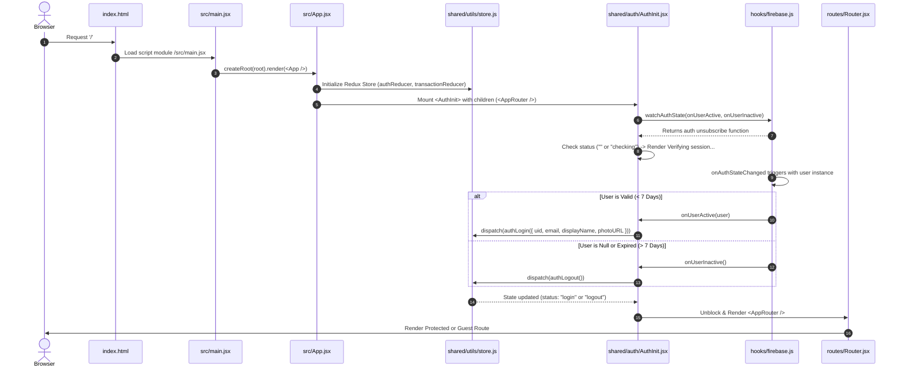
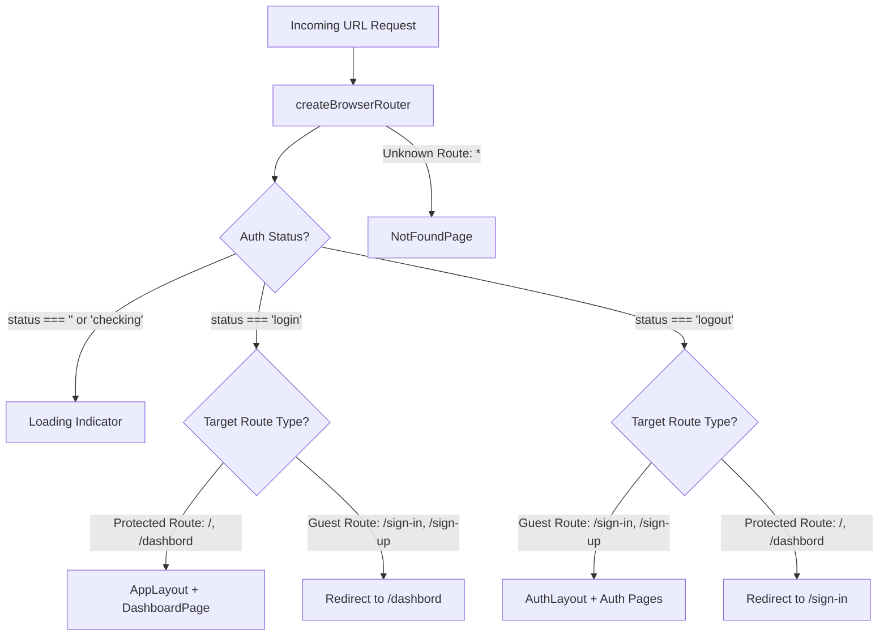
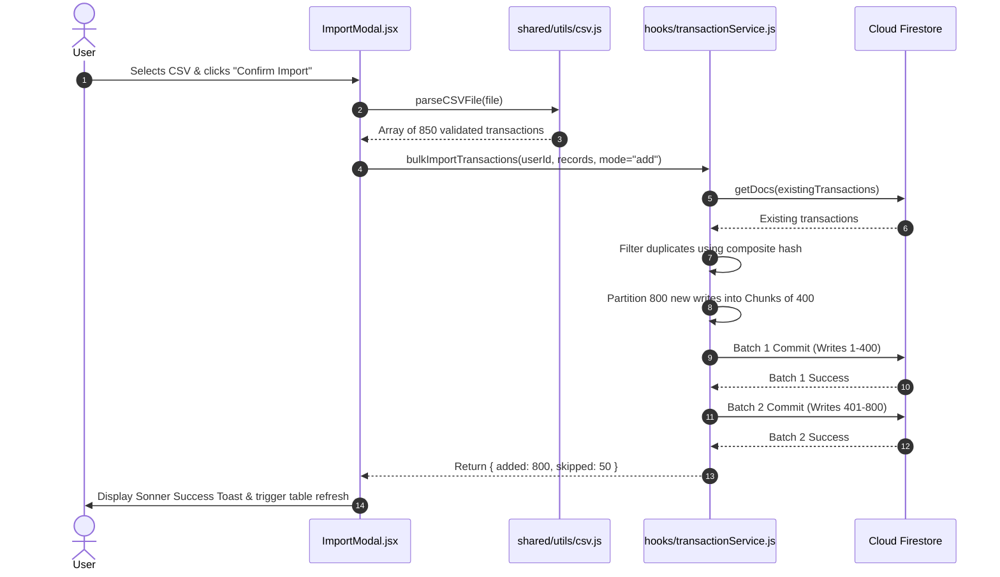
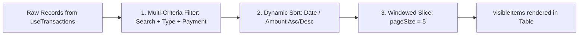

# Financely — System Architecture & Workflow Breakdown

This document provides a comprehensive technical breakdown of **Financely**. It details the end-to-end execution flow, from the browser's initial request to dynamic component rendering, state transitions, security lifecycle, data synchronization with Cloud Firestore, and the atomic UI hierarchy.

---

## Table of Contents
1. [High-Level Architecture Overview](#1-high-level-architecture-overview)
2. [End-to-End Application Bootstrapping](#2-end-to-end-application-bootstrapping)
3. [Authentication, Session Guard & 7-Day Expiry](#3-authentication-session-guard--7-day-expiry)
4. [Routing, Route Guards & Code Splitting (Lazy Loading)](#4-routing-route-guards--code-splitting-lazy-loading)
5. [Global State Management (Redux Store Architecture)](#5-global-state-management-redux-store-architecture)
6. [Transaction Model & Real-Time Financial Aggregation](#6-transaction-model--real-time-financial-aggregation)
7. [Cloud Firestore Services & Chunked Batch Operations](#7-cloud-firestore-services--chunked-batch-operations)
8. [Data Grid Engine: Search, Filter, Sort & Pagination](#8-data-grid-engine-search-filter-sort--pagination)
9. [Smart CSV Engine: Ingestion, Normalization & Export](#9-smart-csv-engine-ingestion-normalization--export)
10. [Atomic UI Component Architecture & Design System](#10-atomic-ui-component-architecture--design-system)
11. [Component Interconnection Matrix](#11-component-interconnection-matrix)

---

## 1. High-Level Architecture Overview

The system follows a reactive, decoupled architecture composed of four core layers:
1. **Presentation Layer:** Atomic UI components and feature-specific components styled with Tailwind CSS v4.
2. **Controller Layer (Custom Hooks):** Pure business logic separating UI rendering from asynchronous workflows (`useTable`, `useTransactions`, `useLogin`, etc.).
3. **State Layer (Redux Toolkit):** Centralized store maintaining session state, transaction filters, active modals, and aggregated chart data with memoized selectors.
4. **Data & Infrastructure Layer (Firebase & PapaParse):** Firebase Authentication, Firestore NoSQL database, and CSV parsing engines.



---

## 2. End-to-End Application Bootstrapping

When a user visits the application, the bootstrap sequence executes in the following deterministic order:



### Source Code Mapping
1. **[index.html](index.html):** Declares viewport metadata, favicon, and the root `<div id="root"></div>`.
2. **[main.jsx](src/main.jsx):** Uses React 19's `createRoot(document.getElementById('root'))` to mount `App`.
3. **[App.jsx](src/App.jsx):** Wraps the app in `<Provider store={store}>`, attaches the global `<Toaster />`, and encloses `<AppRouter />` within `<AuthInit>`.

---

## 3. Authentication, Session Guard & 7-Day Expiry

Authentication is managed via Firebase Auth, fortified with custom session longevity enforcement.

### 3.1 Firebase Configuration & Initialization
* File: **[src/hooks/firebase.js](src/hooks/firebase.js)**
* Configured using Vite environment variables (`import.meta.env.VITE_FIREBASE_*`).
* Exports singletons:
  * `auth`: Initialized with `getAuth(app)`.
  * `db`: Initialized with `getFirestore(app)`.
  * `googleProvider`: Configured with `prompt: "select_account"`.

### 3.2 7-Day Session Verification (`watchAuthState`)
Standard Firebase sessions persist indefinitely in IndexedDB. Financely implements a strict **7-day maximum session security rule**:
```javascript
const MAX_SESSION_MS = 7 * 24 * 60 * 60 * 1000; // 7 days

export function watchAuthState(onUserActive, onUserInactive) {
  return onAuthStateChanged(auth, async (user) => {
    if (!user) {
      onUserInactive();
      return;
    }

    try {
      // Force token retrieval to inspect server-issued auth_time claim
      const idTokenResult = await user.getIdTokenResult();
      const authTimeMs = idTokenResult.claims.auth_time * 1000;
      const currentTime = Date.now();

      // If token issued time exceeds 7 days, force sign out
      if (currentTime - authTimeMs > MAX_SESSION_MS) {
        console.warn("Session exceeded 7 days. Signing user out...");
        await signOut(auth);
        onUserInactive();
        return;
      }

      onUserActive(user);
    } catch (error) {
      await signOut(auth);
      onUserInactive();
    }
  });
}
```

### 3.3 Redux State Sanitization (`authSlice.js`)
* File: **[src/features/auth/authSlice.js](src/features/auth/authSlice.js)**
* Firebase User instances contain recursive methods and internal tokens that are **non-serializable**. Passing raw Firebase objects to Redux triggers serializability warnings.
* `authSlice.js` utilizes RTK's `prepare` action callback to sanitize the user into plain serializable fields:
  ```javascript
  prepare(rawUser) {
    return {
      payload: {
        uid: String(rawUser.uid || ""),
        email: String(rawUser.email || ""),
        displayName: String(rawUser.displayName || ""),
        photoURL: rawUser.photoURL || null,
      },
    };
  }
  ```

### 3.4 Custom Authentication Hooks
* **[useLogin.js](src/hooks/useLogin.js):**
  * `submit(formData)`: Pure email format validation -> `await loginWithEmail()` -> redirects to `/dashbord`.
  * `signInWithGoogle()`: Invokes `await loginWithGoogle()` via popup. Inspects `getAdditionalUserInfo()`. If the Google account is new and was not registered, deletes the account and instructs the user to register first.
* **[useRegister.js](src/hooks/useRegister.js):**
  * Validates full name regex (`NAME_REGEX`), email format, and password complexity (8+ characters, uppercase, lowercase, numbers, special characters).
  * Executes `await registerWithEmail()` -> calls `await updateProfile(user, { displayName })` -> initializes user document in Firestore.
* **[useForgotPass.js](src/hooks/useForgotPass.js):**
  * Validates email format -> invokes `await sendResetEmail()` -> sets `isSent: true`.

---

## 4. Routing, Route Guards & Code Splitting (Lazy Loading)

Routing is orchestrated with **React Router v7** using `createBrowserRouter` in [Router.jsx](src/routes/Router.jsx).



### 4.1 Route Guard Components
1. **`ProtectedRoute`:**
   * Reads `{ user, status }` from `state.auth`.
   * While `status === "checking"` or `status === ""`, renders a placeholder loader.
   * If `user` exists, renders `<Outlet />` (which loads `AppLayout` and `DashboardPage`).
   * If `user` is null, returns `<Navigate to={Routes.SIGNIN} replace state={{ from: location }} />`.
2. **`GuestRoute`:**
   * Reads `{ user, status }` from `state.auth`.
   * If `user` exists, returns `<Navigate to={Routes.DASHBOARD} replace />` (prevents logged-in users from seeing login/signup screens).
   * If `user` is null, renders `<Outlet />` (loads `AuthLayout` and login forms).

### 4.2 Code Splitting with `React.lazy` and `<Suspense>`
All pages are split into separate JavaScript bundles:
```javascript
const DashboardPage = lazy(() => import('@/pages/DashbordPage'));
const SignUpPage = lazy(() => import('@/pages/Auth/SignUpPage'));
const SignInPage = lazy(() => import('@/pages/Auth/SignInPage'));
const ForgotPasswordPage = lazy(() => import('@/pages/Auth/ForgotPasswordPage'));
const NotFoundPage = lazy(() => import('@/pages/NotFoundPage'));
```
* **Suspense Boundaries:** Every `<Outlet />` in [AppLayout.jsx](src/shared/layout/AppLayout.jsx) and [AuthLayout.jsx](src/shared/layout/AuthLayout.jsx) is wrapped in `<Suspense fallback={<LoadingIndicator />}>`. This eliminates white flashes and prevents React suspension runtime exceptions.

### 4.3 Route Error Handling (`ErrorBoundry.jsx`)
* File: **[src/shared/utils/ErrorBoundry.jsx](src/shared/utils/ErrorBoundry.jsx)**
* Registered as `errorElement` on route roots. Catches 404s, 500s, loader failures, and network disconnects using `useRouteError()` and `isRouteErrorResponse(err)`. Provides a "Reload Page" button and a "Go to Home" link.

---

## 5. Global State Management (Redux Store Architecture)

The Redux store is configured in [store.js](src/shared/utils/store.js) using Redux Toolkit.

```text
Redux Root Store
├── auth (authSlice)
│   ├── user: { uid, email, displayName, photoURL } | null
│   ├── status: "checking" | "login" | "logout" | "error" | ""
│   └── error: string | null
│
└── transaction (transactionSlice)
    ├── currentBalance: number (Scalar overall balance)
    ├── summaries: {
    │   ├── totalIncome: number
    │   ├── totalExpense: number
    │   ├── chartData: [{ date, income, expense }]
    │   └── pieData: [{ name, value }]
    │   }
    ├── query: {
    │   ├── search: string (Live search keyword)
    │   ├── transactionType: "all" | "income" | "expense"
    │   └── paymentMethod: "all" | "card" | "cash" | "bank" | "online" | "paper"
    │   }
    ├── dateRange: "all" | "this-month" | "last-month" | "last-30-days" | "year-to-date" | "custom:START:END"
    └── form: {
        ├── type: "income" | "expense"
        ├── openedAt: timestamp
        └── transaction: TransactionRecord | null (Populated for editing)
        } | null
```

### 5.1 Memoized Selectors (`transactionSelector.js`)
To avoid unnecessary re-renders in Recharts and UI components, [transactionSelector.js](src/features/transaction/transactionSelector.js) uses RTK's `createSelector`:
* `selectCurrentBalance`: Memoized scalar balance.
* `selectTotalIncome`: Memoized income sum.
* `selectTotalExpense`: Memoized expense sum.
* `selectIncomeChartData`: Memoized array of time-series objects. Returns frozen empty array if summaries are undefined.
* `selectExpensePieChartData`: Memoized category breakdown.

---

## 6. Transaction Model & Real-Time Financial Aggregation

File: **[src/hooks/transactionModel.js](src/hooks/transactionModel.js)**  
Acts as the **single source of truth** for data contracts, validation, date normalization, and financial math.

### 6.1 Validation Engine (`validateTransaction`)
Every record passing through creation, editing, or CSV import must satisfy:
1. `amount`: Parsed as a positive float, rounded to 2 decimal places. Must be $> 0$ and finite.
2. `name`: Trimmed non-empty string.
3. `type`: Strictly normalized to `"income"` or `"expense"` using exact and word-boundary rules (`/^(income|in|credit|cr|deposit|dep)$/i`).
4. `paymentMethod`: Classified into `"card"`, `"bank"` (includes UPI/wire), `"online"`, `"paper"` (cheques), or `"cash"`.
5. `date`: Normalized via `parseFlexibleDate`.
6. `updatedAt`: ISO timestamp.

### 6.2 Universal Flexible Date Parser (`parseFlexibleDate`)
Handles heterogeneous date formats without crashing:
* **Date Instances:** Converted via `getLocalDateString(d)`.
* **Firestore Timestamps:** Detects `.toDate()` or `.seconds * 1000`.
* **8-Digit Compact String (`YYYYMMDD`):** Captured by `/^(\d{4})(\d{2})(\d{2})$/` and normalized to `YYYY-MM-DD`.
* **Unix Timestamps & Excel Serial Dates:** Distinguishes epoch timestamps ($> 1e9$) from Excel serial day counts (e.g., `45620`), using `(n - 25569) * 864e5`.
* **Delimited Strings (`DD-MM-YYYY` vs `MM/DD/YYYY`):** Evaluates day/month boundary ($> 12$) to distinguish month and day.
* **ISO 8601 Strings (`YYYY-MM-DD`):** Directly normalized.

### 6.3 Aggregation Engine (`computeSummaries`)
Processes a flat list of transactions into chart-ready structures:
```javascript
export function computeSummaries(transactions = [], paymentMethod = "all") {
  // 1. Loops once through transactions: O(N) linear time
  // 2. Populates dailyMap[date] = { date, income, expense }
  // 3. Populates categoryMap[category] = sum(amounts)
  // 4. Sorts dailyMap chronologically for AreaChart
  // 5. Sorts categoryMap descending:
  //    - Takes top 6 categories
  //    - Bundles all remaining categories into "Other"
  // 6. Returns { totalIncome, totalExpense, chartData, pieData }
}
```

---

## 7. Cloud Firestore Services & Chunked Batch Operations

File: **[src/hooks/transactionService.js](src/hooks/transactionService.js)**  
Encapsulates all communication with Cloud Firestore.

### 7.1 Firestore Data Hierarchy
All data is partitioned strictly per user:
```text
Firestore Root
└── users/ (Collection)
    └── {userId}/ (Document: uid, email, displayName, photoURL)
        └── transactions/ (Subcollection)
            └── {transactionId}/ (Document: name, amount, type, category, paymentMethod, date, note, createdAt)
```

### 7.2 Date-Bounded Queries (`fetchTransactions`)
When a date range filter is selected:
1. `getDateBounds(range)` calculates string boundaries `[startStr, endStr]` (e.g., `["2026-10-01", "2026-10-31"]`).
2. Generates an indexed range query:
   ```javascript
   query(
     collection(db, "users", userId, "transactions"),
     where("date", ">=", bounds[0]),
     where("date", "<=", `${bounds[1]}\uf8ff`),
     orderBy("date", "desc")
   )
   ```

### 7.3 Chunked Batch Commit (`bulkImportTransactions`)
Firestore limits `writeBatch()` to **500 operations**. Importing 600 CSV rows or replacing 300 existing records with 300 new ones would exceed this limit.
Financely utilizes `executeBatches()` to slice operations into safe blocks of **400 writes**:
```javascript
async function executeBatches(operations) {
  const CHUNK_SIZE = 400;
  for (let i = 0; i < operations.length; i += CHUNK_SIZE) {
    const batch = writeBatch(db);
    const chunk = operations.slice(i, i + CHUNK_SIZE);
    for (const op of chunk) op(batch);
    await batch.commit(); // Committed sequentially
  }
}
```



---

## 8. Data Grid Engine: Search, Filter, Sort & Pagination

File: **[src/hooks/useTable.js](src/hooks/useTable.js)**  
Controls the client-side data pipeline for [TransactionTable.jsx](src/components/transaction/TransactionTable.jsx).



### Step 1: Multi-Criteria Filtering (`filteredRecords`)
Executed inside `useMemo`:
* Matches search term across `name`, `note`, and `category` concurrently.
* Filters by `transactionType` (`income` / `expense`) unless set to `"all"`.
* Filters by `paymentMethod` (`card`, `cash`, `bank`, etc.) unless set to `"all"`.

### Step 2: Dynamic Sorting (`sortedRecords`)
Executed inside `useMemo`:
* Supports string sorting via `localeCompare(..., { numeric: true })` and numeric sorting for `amount`.
* Manages cycle: `None -> Ascending (↑) -> Descending (↓) -> Reset (↕)`.

### Step 3: Windowed Pagination (`visibleItems`)
* Automatically resets current page to `1` synchronously if filter parameters change.
* Slices records: `sortedRecords.slice((currentPage - 1) * pageSize, currentPage * pageSize)`.

---

## 9. Smart CSV Engine: Ingestion, Normalization & Export

File: **[src/shared/utils/csv.js](src/shared/utils/csv.js)**  

### 9.1 Export Pipeline (`exportToCSV`)
1. Maps filtered transactions into clean export objects with headers: `Name`, `Amount`, `Date`, `Type`, `Payment Method`, `Category`, `Note`.
2. Converts data to CSV string with `Papa.unparse()`.
3. Creates a `Blob` of type `text/csv;charset=utf-8;`.
4. Generates an object URL, mounts a hidden `<a>` tag, triggers `.click()`, and delays `URL.revokeObjectURL(url)` by 1000ms so the browser never drops the download stream.

### 9.2 Resilient CSV Ingestion (`parseCSVFile`)
Users import CSV files from diverse sources (banking portals, Google Sheets, Excel). Column names rarely match exactly.
`findCol(row, keys, keywords)` tokenizes header strings and applies fuzzy/word matching:
* **Amount:** Matches headers containing `amount`, `price`, `val`, `total`, `cost`.
* **Split Debit/Credit Detection:** If a single amount column is missing, detects separate `debit` / `withdrawal` vs `credit` / `deposit` columns and infers both amount and transaction type.
* **Payment Mode:** Matches `pay`, `method`, `mode`.
* **Category:** Matches `cat`, `tag`, `group`.
* **Note:** Matches `note`, `remark`, `memo`.

---

## 10. Atomic UI Component Architecture & Design System

The application strictly applies **Atomic Design principles** in `src/shared/ui/`:

```text
shared/ui/
├── atoms/                # Fundamental building blocks
│   ├── Button.jsx        # Standardized button (types, hover, active scale, disabled)
│   ├── Input.jsx         # Accessible input with cn() utility merging
│   └── Label.jsx         # Styled accessible label with htmlFor binding
├── molecules/            # Composition of 2-3 atoms
│   ├── FormField.jsx     # Label + Input + Field Error message + useId binding
│   └── Modal.jsx         # Backdrop blur + Card + Title + Close button + Escape listener
└── organisam/            # Standalone layout organisms
    ├── Card.jsx          # Rounded-xl container with .my-shadow elevation
    ├── Navbar.jsx        # Sticky header with user avatar, brand title & logout
    └── Footer.jsx        # Responsive footer with links and copyright
```

### 10.1 Tailwind CSS v4 Dynamic Theme System
File: **[src/index.css](src/index.css)**  
Tailwind v4's `@theme inline` registers dynamic CSS custom properties:
```css
@theme inline {
  --color-surface-base: var(--surface-base);
  --color-surface-raise: var(--surface-raise);
  --color-surface-card: var(--surface-card);
  --color-text-1: var(--text-1);
  --color-text-2: var(--text-2);
  --color-text-3: var(--text-3);
  --color-primary: var(--primary);
  --color-border: var(--border);
}
```
* **Light Mode (`:root`):** Clean white cards on soft gray background (`#edeff0`) with vibrant primary blue (`#2970ff`).
* **Dark Mode (`.dark`):** Deep navy cards (`#131c2e`) on obsidian background (`#090d16`) with high-contrast text (`#f8fafc`).

---

## 11. Component Interconnection Matrix

| Component | Depends On | Dispatches / Invokes | State Consumed |
| :--- | :--- | :--- | :--- |
| **`App.jsx`** | `store.js`, `sonner`, `AuthInit.jsx`, `Router.jsx` | Mounts root providers | Global Store |
| **`AuthInit.jsx`** | `firebase.js:watchAuthState` | `authLogin`, `authLogout` | `state.auth.status` |
| **`Navbar.jsx`** | `firebase.js:logoutUser`, `Button` | `navigate(SIGNIN)` | `state.auth.user` |
| **`DashbordPage.jsx`**| Summary cards, Charts, Table, Filter | Organizes 3-tier grid layout | Layout viewport |
| **`Balance.jsx`** | `Card`, `formatCurrencyINR` | Renders scalar balance | `selectCurrentBalance` |
| **`Income.jsx`** | `Card`, `Button` | `openTransactionForm({ type: 'income' })` | `selectTotalIncome` |
| **`Expence.jsx`** | `Card`, `Button` | `openTransactionForm({ type: 'expense' })`| `selectTotalExpense` |
| **`IncomeBarChart.jsx`** | `Recharts`, `CustomDateRangeModal` | `setDateRange` | `selectIncomeChartData`, `dateRange` |
| **`ExpencePieChart.jsx`** | `Recharts:PieChart`, `Card` | Renders category distribution | `selectExpensePieChartData` |
| **`SearchBar.jsx`** | `Card`, `Input` | `setQuery({ search })` | `selectSearchQuery` |
| **`Filter.jsx`** | `Card` | `setQuery({ transactionType, paymentMethod })` | `selectTransactionType`, `selectPaymentMethod` |
| **`TransactionTable.jsx`** | `useTable`, `csv.js`, `StatusForm`, `DeleteModal` | `openTransactionForm`, `removeTransaction`, `exportToCSV` | `useTable()` results, `state.auth.user` |
| **`StatusForm.jsx`** | `Modal`, `FormField`, `Label`, `Button`, `transactionService` | `createTransaction`, `editTransaction`, `closeTransactionForm` | `selectTransactionForm`, `state.auth.user` |
| **`ImportModal.jsx`** | `Modal`, `Label`, `Button`, `csv.js`, `transactionService` | `bulkImportTransactions` | `userId`, Local file state |
| **`DeleteConfirmModal.jsx`** | `Modal`, `Button` | `confirmDelete` | `transactionToDelete` prop |

---

## Summary
Financely provides an end-to-end reactive pipeline:
* **Security First:** Strict token longevity verification prevents stale session exploitation.
* **Predictable Flow:** Actions flow unidirectionally through Redux slices, computing memoized summaries for Recharts and paginated views.
* **Fault Tolerant:** Safe batching prevents Firestore quota exceptions, comprehensive date parsing prevents parsing corruption, and `<Suspense>` boundaries maintain fluid route transitions.
